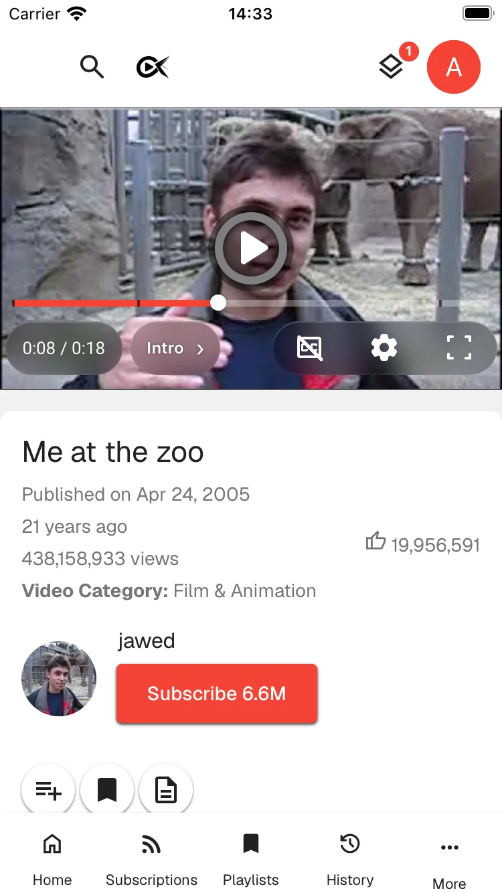

## Playback

### Per-channel playback settings

Manage and automatically apply playback speed, video quality, subtitles, and
volume for individual channels, including channels on Twitch, SoundCloud,
PeerTube, Rumble and Odysee. Playback speeds can be saved automatically when
you change them through the player options, or you can leave automatic saving
off and use the dedicated button below the player to save the current speed for
that channel manually. One switch in Channel Settings turns all channel
playback settings off without deleting them. Import speeds saved by the
Youtube Speed By Channel userscript from Data & Storage settings.

<picture>
  <source media="(prefers-color-scheme: dark)" srcset="https://github.com/user-attachments/assets/bbec3cfc-f1ce-47b1-866a-54c515697d17">
  <source media="(prefers-color-scheme: light)" srcset="https://github.com/user-attachments/assets/7a917c90-4185-4d27-a4a0-1a76faca6de7">
  
</picture>

### Music player and Music Mode

YouTube Music audio tracks and audio-only formats use a dedicated artwork
player with an optional animated audio visualizer.

Enable the Music Mode control in Playback settings, then turn it on from the
player menu. New videos in that tab start from the beginning at 1×, regardless
of saved progress or your usual speed. A headphone badge marks the active mode.
The mode resets when you restart the app. Video cards mark music videos with a
music note, and music videos opened from lists, the queue or autoplay start at
normal speed.

### Play media from other sites

Paste a compatible video or audio link from another site to play it in a Watch
tab through yt-dlp. These videos get the same side panels as YouTube videos,
including chapters, transcripts and live chat, and keep playing in the mini
player when you leave them. They appear in your watch history and under
Continue Watching on Home, and their watch progress syncs between your devices.
Twitch live streams can be rewound to the start of the broadcast when the
channel keeps its videos. Watching media from other sites counts toward your
watch statistics.

<picture>
  <source media="(prefers-color-scheme: dark)" srcset="https://github.com/user-attachments/assets/1bac3b0e-1f4b-47ea-aa6a-4191f966066b">
  <source media="(prefers-color-scheme: light)" srcset="https://github.com/user-attachments/assets/68f72884-d34d-4030-91f0-79ec4b32ae1c">
  
</picture>

### Preload upcoming videos and playlists

Preload upcoming yt-dlp videos from the watch queue, playlist or
recommendations, or prepare an entire playlist before watching. Choose how
many videos to prepare and how many extractions to run concurrently.
Preloading prepares stream URLs to reduce playback delays; use Downloads to
save videos for offline playback.

<picture>
  <source media="(prefers-color-scheme: dark)" srcset="https://github.com/OpenTubeX/media/releases/download/attachments/20261021T120235Z-playlist-preload-menu-dark-dark-d54f7c6182.png">
  <source media="(prefers-color-scheme: light)" srcset="https://github.com/OpenTubeX/media/releases/download/attachments/20261021T120235Z-playlist-preload-menu-light-light-b102e694bb.png">
  
</picture>

### Playback-rate aware seeking and timestamps

Choose whether seek intervals (arrow keys and J/L) are multiplied by the
playback rate, and optionally show timestamps adjusted for the current
playback rate.

### Chapters

Hover over the seek bar to see chapter tooltips, and follow along in a
chapters list in the sidebar. Drag its handle to resize the panel. The list
stays where you scroll it, and **Sync to video time** brings it back to the
current chapter. Each chapter has a loop button that repeats it until you
press it again. YouTube's auto-generated chapters are shown with a note.

<picture>
  <source media="(prefers-color-scheme: dark)" srcset="https://github.com/user-attachments/assets/3b0c5ae9-11b6-485a-bba5-3c59f747c4f2">
  <source media="(prefers-color-scheme: light)" srcset="https://github.com/user-attachments/assets/718d931f-e0b1-4b2c-b255-f68627d9443a">
  
</picture>

### Most-replayed moments

Hover over the seekbar to see YouTube's popularity graph when available.
Peak previews identify the most-replayed moments alongside chapter and
SponsorBlock labels. Hide the graph in Focus settings if you prefer a simpler
timeline.

### Seek bar filmstrip and precise seeking

Drag the seek bar to see a strip of frames around where you'll land. On long
videos, pull up past the middle of the strip to seek precisely: the marker
stays in place while the frames scroll at a finer scale. A hint fills as you
pull up, dragging back down returns to normal seeking, and <kbd>Esc</kbd>
cancels the drag. Fullscreen swipe-to-seek shows the same preview. Turn off
**Show seek bar filmstrip** in Player settings to see a single thumbnail
instead.

<picture>
  <source media="(prefers-color-scheme: dark)" srcset="https://github.com/user-attachments/assets/3185cd8e-b0e3-4c00-a03c-93599a8b8f68">
  <source media="(prefers-color-scheme: light)" srcset="https://github.com/user-attachments/assets/c310aaba-768f-4a20-b8e2-62c342328228">
  
</picture>

### Transcript panel

Follow a video's transcript in a dedicated panel.

### Caption style and timing

Style captions from the Style page in the player's captions menu: font,
colors, opacity, size, edge style and position. Font size and background
opacity have sliders, and the caption settings show color swatches and
preview each option on a sample caption. Captions grow and shrink with the
player, so they cover the same share of the video in a window, in fullscreen
and in the mini player.

If captions appear too early or late, open **Adjust timing** in the Captions
menu to shift them by a chosen number of seconds. Changes apply immediately to
the current video; opening another video resets the offset.

<picture>
  <source media="(prefers-color-scheme: dark)" srcset="https://github.com/user-attachments/assets/b0c31f98-4ddd-4d3f-beab-76eec5e9765c">
  <source media="(prefers-color-scheme: light)" srcset="https://github.com/user-attachments/assets/182741c5-00d3-4da4-8744-5ebc5cbde1dd">
  
</picture>

### Caption translation and secondary captions

Choose a preferred caption language, and translate captions into any language
offered by YouTube. Show a second caption track alongside the main captions,
for example to read a translation and the original language together. The
auto-translation you pick in the player is kept for later videos. You can also
load a local SRT or WebVTT file for the current video from the captions menu.

### Prevent YouTube translations

Keep original titles and descriptions instead of YouTube's translations.
The **Entire App** untranslated-text option also restores original channel
names in search results, and channel names and descriptions on channel pages.

<picture>
  <source media="(prefers-color-scheme: dark)" srcset="https://github.com/user-attachments/assets/912f2e47-9b09-4a97-8262-f0eb63d4bc10">
  <source media="(prefers-color-scheme: light)" srcset="https://github.com/user-attachments/assets/be24f851-7fb9-46ab-b616-2ceffab325c5">
  
</picture>

### Auto Picture-in-Picture

Automatically enter Picture-in-Picture when you switch tabs, minimize the app,
or switch windows. On desktop, the Picture-in-Picture window reopens where you
left it and at the same size, even after a restart. On Linux, this needs KDE
Plasma.

### Cast to Google Cast, FCast and DLNA devices

Google Cast and FCast casting are supported on Android and desktop, and DLNA
casting on Android, desktop and iOS/iPadOS. Turn on each protocol in Player
settings, then choose a device from the cast button
in the player. On desktop, devices from every enabled protocol appear in one
list; on phones, each protocol has its own submenu. While casting, the menu
becomes a remote with seek and volume sliders, playback buttons, and subtitle
choices. FCast receivers don't get subtitles. Stop casting to return to
playback in OpenTubeX.

<picture>
  <source media="(prefers-color-scheme: dark)" srcset="https://github.com/user-attachments/assets/b8379383-2737-4f33-a4a2-1f7aad5d696e">
  <source media="(prefers-color-scheme: light)" srcset="https://github.com/user-attachments/assets/e0bfca57-dd14-461f-a28f-a7427602f293">
  
</picture>

### Mini player and pinned player

Keep watching when you scroll down a video page, leave the Watch page, or
switch to another tab. When there's room, such as on phones in portrait or on
vertical monitors, scrolling down pins the full-size player to the top;
otherwise the video shrinks into the mini player. Choose what happens in
Player settings with **When scrolling down** and **When leaving a video**. Use
the mini player's controls to return to the source tab or hide the player
without interrupting playback. On desktop, double-click the mini player to
return to the full player.

On mobile, the bottom player includes playback progress, play/pause, 10-second
seeking, and previous/next controls when available. Drag the progress line to
seek, tap or swipe up to reopen the video, or swipe down to close the player.
An optional compact layout lets you expand the controls when needed.

<picture>
  <source media="(prefers-color-scheme: dark)" srcset="https://github.com/OpenTubeX/media/releases/download/attachments/20261108T113154Z-mini-player-double-click-dark-dark-79ceccf9f8.webp">
  <source media="(prefers-color-scheme: light)" srcset="https://github.com/OpenTubeX/media/releases/download/attachments/20261108T113154Z-mini-player-double-click-light-light-f771a64153.webp">
  
</picture>

<picture>
  <source media="(prefers-color-scheme: dark)" srcset="https://github.com/user-attachments/assets/460f6fd4-5580-4a82-b17e-31588bac9ecc">
  <source media="(prefers-color-scheme: light)" srcset="https://github.com/user-attachments/assets/2d0b8401-ae70-4cb4-9393-7e5cf2e16b5a">
  
</picture>

<picture>
  <source media="(prefers-color-scheme: dark)" srcset="https://github.com/user-attachments/assets/1c4a69fe-1d90-4bf0-8b90-6086835632fb">
  <source media="(prefers-color-scheme: light)" srcset="https://github.com/user-attachments/assets/c0c5db79-de43-47fc-a9d0-8418b0034474">
  
</picture>

### YouTube end-screen annotations

Show YouTube end-screen annotations inside the player.

### Autoplay preview and end-screen recommendations

See the next video and its countdown directly on the player before autoplay
starts it. When autoplay is off, finished videos show a darkened poster with up
to six recommended videos if recommendations are enabled and **Hide End-Screen
Recommendations** is off in Focus settings.

### Playback speed controls

Add an optional, fully customizable quick playback speed bar to the regular and
YouTube-style Shorts players. Hold <kbd>Space</kbd> or the left mouse button
over the player to speed up temporarily, and choose the multiplier with **Hold
to Speed Up** in Player settings, up to 4×. Press <kbd>G</kbd> to toggle
between 1× and your last used speed.

<picture>
  <source media="(prefers-color-scheme: dark)" srcset="https://github.com/user-attachments/assets/0d376ff5-25d9-4123-8056-ce324d24da69">
  <source media="(prefers-color-scheme: light)" srcset="https://github.com/user-attachments/assets/971472ff-ca07-43cf-85b5-8e28ffb55ff9">
  
</picture>

### Skip silence

Jump over detected silent parts of a video. Enable this behavior in Player
settings, and choose whether new tabs start with it enabled. Not available on
iOS.

### A-B repeat

Repeat a selected part of a video with draggable markers, player-menu controls,
and configurable keyboard shortcuts.

### Volume boost, mono audio and loudness normalization

Make quiet videos louder with up to 200% volume. Turn on **Show Volume Boost
Toggle** in Playback settings, then pick 125%, 150%, 175% or 200% from the
player menu. The boost applies to the current tab and resets in new tabs.

On desktop and Android, **Normalize Loudness** turns down videos loaded with
the Local API that are louder than most, so the volume doesn't jump between
videos. **Mono Audio** plays both audio channels in both ears, for videos
whose sound only comes out of one side. Turn it on in Player settings, or
switch it from the player menu. These options are not available on iOS.

### Seek history

Turn on **Enable Seek History** in Playback settings to get back to where you
were after a mistaken seek. The player menu lists the positions you jumped away
from with their chapter and how long ago you left them, and <kbd>Ctrl</kbd> +
<kbd>Z</kbd> and <kbd>Ctrl</kbd> + <kbd>Shift</kbd> + <kbd>Z</kbd> step back and
forward through them.

### Rewind on Resume

Set **Rewind on Resume** in Player settings to jump back a few seconds when you
resume a paused video, so you don't lose track of what was happening. A
minimum pause length keeps short pauses from rewinding.

<picture>
  <source media="(prefers-color-scheme: dark)" srcset="https://github.com/user-attachments/assets/4c6f8ab5-4301-4519-a8f1-b25070da413b">
  <source media="(prefers-color-scheme: light)" srcset="https://github.com/user-attachments/assets/ef1a5037-0527-4c79-8add-b1a5b2fe3aec">
  
</picture>

### Sleep timer

Stop playback after a chosen duration, when the current chapter ends, or when
the current video ends.

### Playlist playback controls

Reorder or remove playlist items during playback and remember the reverse state
of each playlist. On desktop, videos in the watch page playlist have a one-tap
Remove button on their thumbnails.

### Rewind live streams and premieres

The built-in [stream extraction method](/docs/providers/#choose-a-stream-extraction-method)
plays live streams and premieres in up to 4K and can rewind them, except in the
web demo. Streams with live captions, and some others, play at the live edge
without seeking. To rewind those, use **yt-dlp** when YouTube provides a
rewindable stream. OpenTubeX Lite and the web demo have no yt-dlp. Streams with
DVR disabled cannot be rewound.

### YouTube-style Shorts

Choose between a YouTube-style Shorts layout and player or the regular video
grid and player. Shorts follow your finger during vertical swipes, keep
recent videos buffered at their playback positions, and preload upcoming
streams for faster navigation.

### Live streams, premieres, and chat replay

Automatically refresh upcoming premieres, view comments during premieres, and
use chat replay. Video lists and metadata tell premieres apart from live
streams. Live chat also supports optional timestamps, top or all messages, and
a full-screen dock. Click a chatter's handle to open their channel.

### Voice-over translation

Translate supported videos through the unofficial Yandex API with synchronized
voice-over audio and separate translated and original volume controls. Turn it
on in Add-ons settings first; it is off by default. Available on desktop and
Android.

<video controls preload="metadata" src="https://github.com/user-attachments/assets/0df65773-8f13-4c5e-90d6-2db9106dea98"></video>

### Interactive 360° videos

Watch supported 360° videos in an interactive panorama. Drag inside the player
to look around; clicking still plays or pauses the video.

### Mobile player gestures

Swipe horizontally in fullscreen to seek, with a target-time display and frame
previews when available. Enable or disable the gesture in Playback settings.
The swipe-to-seek preview can be turned off while keeping the seek-bar
feedback. In fullscreen, brightness, volume and playback speed swipes show only
their indicator, without revealing the player controls. Rotating your phone can
enter fullscreen automatically; Android also offers an option to ignore the
system rotation lock for this behavior.

### Video zoom and pan

Zoom into videos from the player menu. Press <kbd>Z</kbd> to zoom in,
<kbd>Shift</kbd> + <kbd>Z</kbd> to zoom out, or hold <kbd>Shift</kbd> and drag to
pan the visible area.

### Video codec and quality preferences

Choose a preferred video codec in Advanced settings. Its tooltip explains how
AV1, VP9 and H.264 differ in data use, battery use and available resolutions.
When a video is available in several codecs, switch between them in the header
of the resolution menu. **Auto** prefers codecs your device can decode in
hardware.

On Android, set **Quality Limit on Metered Networks** in Playback settings so
videos start at a lower quality on mobile data and other metered networks. You
can still choose a higher quality in the player.

### Buffering presets

Choose how much video loads ahead, how much stays loaded for rewinding, and how
much must load before playback starts in **Settings → Advanced → Buffering**.
Pick the Data Saver, Default or Smooth Playback preset or adjust the sliders,
each with a note on its trade-off between data use, memory and start-up delay.
Changes apply to the video that is already playing.

<picture>
  <source media="(prefers-color-scheme: dark)" srcset="https://github.com/user-attachments/assets/b8e1aaa1-644c-41f5-832f-52a2a25a4521">
  <source media="(prefers-color-scheme: light)" srcset="https://github.com/user-attachments/assets/be836c99-b6a1-4bf7-a838-a64cdedbb55d">
  
</picture>

## Subscriptions and library

### Return YouTube Dislike support

Show dislike count using [Return YouTube Dislike](https://returnyoutubedislike.com/).

### Follow channels on other platforms

Follow channels on Twitch, SoundCloud, PeerTube, Rumble and Odysee without an
account. Their uploads and live streams appear in a Platforms tab on the
Subscriptions page and in the New feed, their channels and playlists open in
the app, and search covers these platforms. You can get a notification when a
Twitch channel goes live. Following other platforms needs yt-dlp, so the web
app and OpenTubeX Lite stay YouTube-only.

<picture>
  <source media="(prefers-color-scheme: dark)" srcset="https://github.com/user-attachments/assets/80cffe1d-e3c0-4de4-8fcc-4ad1e0d25d96">
  <source media="(prefers-color-scheme: light)" srcset="https://github.com/user-attachments/assets/56f6a3df-b13c-4781-a6b6-c1ff42b97843">
  
</picture>

### RSS feeds

Follow creators anywhere else through RSS and Atom feeds in an optional RSS tab
on the Subscriptions page. Turn it on in Subscription settings. To add a feed
from [RSSHub](https://docs.rsshub.app/), pick an instance, a service and a
username instead of writing the address yourself. Feeds refresh automatically
and together with your subscriptions, new items appear in the New feed, and
seen marks sync between your devices. Mark items as watched, download them, or
copy their link from their context menu.

<picture>
  <source media="(prefers-color-scheme: dark)" srcset="https://github.com/user-attachments/assets/b7259fb2-fb84-4982-9229-d24a311de2d3">
  <source media="(prefers-color-scheme: light)" srcset="https://github.com/user-attachments/assets/47f58748-6e1c-409f-b03c-83df02bd5916">
  
</picture>

<picture>
  <source media="(prefers-color-scheme: dark)" srcset="https://github.com/user-attachments/assets/467ccb78-5aaa-4536-8c27-2e7ef1f31265">
  <source media="(prefers-color-scheme: light)" srcset="https://github.com/user-attachments/assets/29b0add3-4a77-4d37-b259-b7deae63e3c3">
  
</picture>

### Per-channel subscription feed controls

Choose whether each channel appears in Videos, Shorts, Live and Posts, set a
daily video limit, and enable members-only videos when playback cookies are
configured. Members-only videos only appear for channels where you enabled
them, including on channel pages, in search and in recommendations. Batch-edit
channel preferences in Subscription settings, add subscribed channels directly
to Saved Channel Settings, or hide a channel's content type from the feed menu.

<picture>
  <source media="(prefers-color-scheme: dark)" srcset="https://github.com/OpenTubeX/media/releases/download/attachments/20260907T111835Z-channel-feed-dark-dark-f534fb0d44.png">
  <source media="(prefers-color-scheme: light)" srcset="https://github.com/OpenTubeX/media/releases/download/attachments/20260907T111835Z-channel-feed-light-light-063edf63b2.png">
  
</picture>

### Subscription groups

Sort subscribed channels into groups, such as Music or Gaming, and select a
group in the Subscriptions header to filter every feed tab. Give each group an
icon, shown beside its name in the group tabs and the subscribe button's group
list. Manage groups from the Channels page or a channel's subscription
settings. Channels can be sorted by name or arranged in a custom order with
drag and drop or the arrow keys, and the side navigation follows the same
order. Groups and the channel order sync with your settings.

<picture>
  <source media="(prefers-color-scheme: dark)" srcset="https://github.com/user-attachments/assets/ca3bab83-8e71-4503-8a85-fc30e3a3f12d">
  <source media="(prefers-color-scheme: light)" srcset="https://github.com/user-attachments/assets/20fe6890-3030-4fc9-880c-d7644ca2574f">
  
</picture>

### Subscription feed refresh

Refresh subscriptions automatically on a schedule, see new videos right away
while the rest loads, and cancel a refresh at any time. Channels that could not
be refreshed, including in background refreshes, appear once each in a box
above the feeds, where you can open them, unsubscribe from channels that no
longer exist, or retry the others. The experimental **Faster Subscription
Refresh** setting skips reloading channels without new uploads; in exchange,
their view counts and other details update less often.

<picture>
  <source media="(prefers-color-scheme: dark)" srcset="https://github.com/user-attachments/assets/0207ba25-f8e0-4564-bbbe-39c9b6d79d2f">
  <source media="(prefers-color-scheme: light)" srcset="https://github.com/user-attachments/assets/5274185e-90da-4763-913f-fa83adb118d7">
  
</picture>

### New subscription content

Show indicators for newly fetched content and optionally collect it in a
separate New feed, including new items from RSS feeds and other platforms.
Sort that feed with the oldest content first or switch its categories between
combined sections and tabs. Mark everything as seen from the button beside the
title.

<picture>
  <source media="(prefers-color-scheme: dark)" srcset="https://github.com/OpenTubeX/media/releases/download/attachments/20260827T200027Z-new-feed-tabbed-dark-dark-8c5a594149.png">
  <source media="(prefers-color-scheme: light)" srcset="https://github.com/OpenTubeX/media/releases/download/attachments/20260827T200027Z-new-feed-tabbed-light-light-e57a70f649.png">
  
</picture>

### Upload, live stream, and premiere notifications

Turn on the bell in a channel's subscribe button to get a notification when
the channel uploads a video, short, live stream or post. Choose which types
notify you from the subscribe button's settings, or for many channels at once
in Subscription settings. OpenTubeX checks for new uploads when subscriptions
refresh, including background refreshes. Upload notifications are available on
desktop and Android.

You can also get a notification when a scheduled live stream or premiere
starts.

While you use OpenTubeX, notifications appear inside the app. While it runs in
the background, they arrive as system notifications. The bell in the top bar
lists past notifications with an unread count. Open one from there, in a new
tab with a middle-click, or mark it as read. Notifications you read, remove or
clear sync between your devices. Under Notifications in General settings,
System and in-app is the default. Choose System only to always use system
notifications without that list, or Off to turn notifications off. You can
also hide routine notifications that only confirm an action.

<picture>
  <source media="(prefers-color-scheme: dark)" srcset="https://github.com/user-attachments/assets/f20f4ab1-5296-4db8-a930-05ca1d41242e">
  <source media="(prefers-color-scheme: light)" srcset="https://github.com/user-attachments/assets/0bd0b8af-c34c-46b0-b11a-e897709cf7a5">
  
</picture>

<picture>
  <source media="(prefers-color-scheme: dark)" srcset="https://github.com/user-attachments/assets/33b85808-4f80-4de6-a725-a8943573ed48">
  <source media="(prefers-color-scheme: light)" srcset="https://github.com/user-attachments/assets/56b2b10a-0437-485a-a8a2-f1539f6eb6ba">
  
</picture>

### Watch history

Find watched videos by date range or channel alongside text search. Filters
apply across your history, including entries on other pages. Collapse the
filter controls without losing your selections, or return to History with
your search, filters, and page restored. **Delete Old History** can remove
entries older than a chosen age or your entire history.

Choose how much of a video must play before it counts as watched; set the
threshold to 0% to mark videos as watched immediately. Channel pages have a
**Hide Watched** switch for videos, Shorts and live streams.

<picture>
  <source media="(prefers-color-scheme: dark)" srcset="https://github.com/user-attachments/assets/3ef463be-15e1-4910-93f9-04ddcc92c376">
  <source media="(prefers-color-scheme: light)" srcset="https://github.com/user-attachments/assets/86ff8f6b-4f3f-4d3b-82bd-f1550ca14185">
  
</picture>

### Watch time statistics

Explore your viewing activity with daily and weekly watch-time charts. When
statistics sync is enabled, choose a device or **All devices** above the charts.
The combined view adds each device's recorded watch time. To reset or adjust
imported watch time, select the current device. If reconnecting created a
duplicate device, **Replace old device** previews the combined history and lets
you choose how to handle overlapping daily totals.

See [sync setup](/docs/sync/#choose-what-to-sync) to choose what to synchronize.

<picture>
  <source media="(prefers-color-scheme: dark)" srcset="https://github.com/user-attachments/assets/e0d2162c-99e9-4ddb-8073-9f6a283dcd9b">
  <source media="(prefers-color-scheme: light)" srcset="https://github.com/user-attachments/assets/11d21c44-1838-4af2-b41a-e5894f1c387f">
  
</picture>

### Additional video metadata

See more context about a video, including AI-generated content labels,
paid-promotion disclosures, collaborators, categories, games, tags, relative
publication dates, comment counts, age restrictions, and unlisted status.
Verified and official artist badges mark channels across the app. The watch
page lists the songs credited in a video and shows YouTube's information
panels, such as topic context and public broadcaster notices, with their
sources. Channel avatars can also be shown beside channel names in video and
playlist results.

<picture>
  <source media="(prefers-color-scheme: dark)" srcset="https://github.com/user-attachments/assets/ee3a88dc-df27-49ff-b84d-c0ffd6ed77db">
  <source media="(prefers-color-scheme: light)" srcset="https://github.com/user-attachments/assets/302d09a4-f444-4fed-9347-b21700d1d2cf">
  
</picture>

<picture>
  <source media="(prefers-color-scheme: dark)" srcset="https://github.com/OpenTubeX/media/releases/download/attachments/20260827T091534Z-938-channel-avatars-dark-dark-56df4bda9e.png">
  <source media="(prefers-color-scheme: light)" srcset="https://github.com/OpenTubeX/media/releases/download/attachments/20260827T091534Z-938-channel-avatars-light-light-3fa490d1b6.png">
  
</picture>

### Hashtag Shorts and stats

Hashtag pages show how many videos and channels use the hashtag and have a
Shorts tab that keeps loading more Shorts.

<picture>
  <source media="(prefers-color-scheme: dark)" srcset="https://github.com/user-attachments/assets/5e1d0941-84ee-4fbe-b33b-c65daf00a848">
  <source media="(prefers-color-scheme: light)" srcset="https://github.com/user-attachments/assets/e68ea3c2-1638-4f4e-972d-2a6b97ced9f8">
  
</picture>

### Trending music

The Music tab on Trending shows the YouTube Music chart for your selected
region.

### Playlist browsing and saved YouTube playlists

Choose an independent Grid or List view for playlist pages and switch it from
Quick settings. Search within YouTube playlists, with results from every page
of the playlist. Save YouTube playlists as read-only bookmarks in Your
Playlists; they sort by when their channel last updated them, and one button
refreshes them all. Copy complete YouTube playlists into editable local
playlists, then append missing videos from the source while preserving local
order and additions. Copying keeps running in the background after you leave
the playlist.

<picture>
  <source media="(prefers-color-scheme: dark)" srcset="https://github.com/user-attachments/assets/75298297-b4f4-4bcb-82be-9f09b60d73d9">
  <source media="(prefers-color-scheme: light)" srcset="https://github.com/user-attachments/assets/7f381e50-62bb-4079-88bf-e26c17061dc2">
  
</picture>

<picture>
  <source media="(prefers-color-scheme: dark)" srcset="https://github.com/OpenTubeX/media/releases/download/attachments/20260830T075432Z-saved-playlist-dark-dark-815812ca6c.png">
  <source media="(prefers-color-scheme: light)" srcset="https://github.com/OpenTubeX/media/releases/download/attachments/20260830T075432Z-saved-playlist-light-light-fdb2f428ab.png">
  
</picture>

### Playlist customization

Choose an image for a local playlist's thumbnail, replace it later, or restore
the default. Custom thumbnails appear in playlist cards, headers, Home, and
playlist selection menus. They stay in backups and can sync between devices
with a supporting sync server or Enhanced Privacy enabled.

In **Edit Playlist Info**, choose whether new videos go to the top or bottom
of that playlist's custom order, shuffle the playlist by default, or remove
each video once you've watched it from the playlist. These options sync to
your other devices.

Pin playlists to the top of the Playlists page from their context menu, or
arrange Your Playlists in a custom order with drag and drop. Reorder playlists
and their videos with the arrow keys. Each playlist remembers its own sort
order, and encrypted sync carries it to your other devices.

<picture>
  <source media="(prefers-color-scheme: dark)" srcset="https://github.com/user-attachments/assets/964b6069-1d8d-4897-b3c6-44d98f71eef9">
  <source media="(prefers-color-scheme: light)" srcset="https://github.com/user-attachments/assets/a15cdc05-20ef-4036-a7d4-f7c9c8777c84">
  
</picture>

<picture>
  <source media="(prefers-color-scheme: dark)" srcset="https://github.com/user-attachments/assets/e3803624-a338-4287-871e-dc15e87709e6">
  <source media="(prefers-color-scheme: light)" srcset="https://github.com/user-attachments/assets/6240a3f3-e512-4dc6-a434-bfb04ece168f">
  
</picture>

### Unavailable playlist videos

Optionally skip known unavailable videos while playing a playlist. You can
also scan an editable local playlist for confirmed unavailable entries and
choose whether to remove them. Videos that could not be checked are kept.

<picture>
  <source media="(prefers-color-scheme: dark)" srcset="https://github.com/user-attachments/assets/bf8bb31e-42a3-439e-a798-d58898ec2148">
  <source media="(prefers-color-scheme: light)" srcset="https://github.com/user-attachments/assets/64e64e64-3485-4e15-b5e5-80262dbb5089">
  
</picture>

### Repair playlist metadata

Restore missing video titles, channel details, publication dates, and durations
after a YouTube Takeout import. Select individual playlists or repair them all
from the Playlists page. Repair preserves playlist order, existing details,
and watch progress, with progress reporting, cancellation, and optional
configured yt-dlp cookies.

<picture>
  <source media="(prefers-color-scheme: dark)" srcset="https://github.com/user-attachments/assets/b8eb6ba1-f713-497a-a47c-8a977b6f4a1f">
  <source media="(prefers-color-scheme: light)" srcset="https://github.com/user-attachments/assets/61facc94-f4ab-48c4-a307-1e6d7f7d4019">
  
</picture>

### Comment tools

Render nested reply threads, show when comments were edited, reload comments,
or copy a comment's direct YouTube link. Translate comments and replies into
the app language, search loaded comments, filter comments from the creator,
and pin comments locally. On mobile, preview the first five loaded comments
with author avatars below the video, then tap to open the full discussion.
GIF attachments in comments and replies animate while hovered.

<picture>
  <source media="(prefers-color-scheme: dark)" srcset="https://github.com/OpenTubeX/media/releases/download/attachments/20261004T082407Z-opentubex-comment-preview-dark-dark-90cad7b700.webp">
  <source media="(prefers-color-scheme: light)" srcset="https://github.com/OpenTubeX/media/releases/download/attachments/20261004T082407Z-opentubex-comment-preview-light-light-7cca1fe570.webp">
  
</picture>

<picture>
  <source media="(prefers-color-scheme: dark)" srcset="https://github.com/OpenTubeX/media/releases/download/attachments/20260827T091534Z-936-comment-translation-dark-dark-3c214f1e9e.png">
  <source media="(prefers-color-scheme: light)" srcset="https://github.com/OpenTubeX/media/releases/download/attachments/20260827T091534Z-936-comment-translation-light-light-4114bb3ad8.png">
  
</picture>

<picture>
  <source media="(prefers-color-scheme: dark)" srcset="https://github.com/OpenTubeX/media/releases/download/attachments/20260827T091534Z-939-comment-search-pins-dark-dark-6a86772413.png">
  <source media="(prefers-color-scheme: light)" srcset="https://github.com/OpenTubeX/media/releases/download/attachments/20260827T091534Z-939-comment-search-pins-light-light-6dc1798855.png">
  
</picture>

### Watch queue

Queue videos from their three-dot menus, then manage and drag to reorder them
in a side panel on the watch page. Queued videos show their length, views and
upload date, and a menu moves or removes them. Save the queue to a new or
existing playlist, or add a whole playlist to the end of the queue from its
page. Downloaded videos and audio can also join the queue for offline playback
on desktop and Android. Pending videos return in their saved order after
restarting OpenTubeX, including downloaded entries.

<picture>
  <source media="(prefers-color-scheme: dark)" srcset="https://github.com/user-attachments/assets/7a5da83d-f281-47b1-9e9d-da81961fcdbc">
  <source media="(prefers-color-scheme: light)" srcset="https://github.com/user-attachments/assets/74f67075-8309-44d1-bdf3-4d6b15b7353f">
  
</picture>

### Inline add-to-playlist

Choose playlists from an inline popover, and personalize the quick-bookmark
playlist with an icon, emoji, or cropped image. On phones, the playlist picker
lists playlists as compact rows. While watching, press <kbd>B</kbd> to add the
video to the quick-bookmark playlist or remove it, or <kbd>Shift</kbd> +
<kbd>S</kbd> to save it to a playlist.

## Focus and wellbeing

### Digital Wellbeing

The Digital Wellbeing tab in Focus settings sets daily limits for watch time
and Shorts, reminds you to take breaks, and has a bedtime reminder that can
silence upload notifications. Grayscale mode shows the app in shades of gray,
always or only during bedtime, and can apply to videos and images only so the
interface keeps its colors.

<picture>
  <source media="(prefers-color-scheme: dark)" srcset="https://github.com/user-attachments/assets/1414520a-d711-47d3-ab40-fd7cda17e502">
  <source media="(prefers-color-scheme: light)" srcset="https://github.com/user-attachments/assets/56c7abd2-0451-44c5-9f78-2d83d5b5bba1">
  
</picture>

### Channel and phrase block lists

Hide channels directly from channel-link context menus, or filter content with
saved channel and phrase block lists in Focus settings. Blocked videos,
playlists, channels and posts can be blurred instead of hidden; click one to
show it. Temporarily pause both lists from settings or an optional Quick
Settings control without deleting your entries.

<picture>
  <source media="(prefers-color-scheme: dark)" srcset="https://github.com/user-attachments/assets/a63ded12-3b9f-466b-aead-a65957eab9b9">
  <source media="(prefers-color-scheme: light)" srcset="https://github.com/user-attachments/assets/1882cf4a-69d6-4881-8da8-9b49915f564d">
  
</picture>

<picture>
  <source media="(prefers-color-scheme: dark)" srcset="https://github.com/user-attachments/assets/48413b19-766e-405d-a2bd-42e0c01717cd">
  <source media="(prefers-color-scheme: light)" srcset="https://github.com/user-attachments/assets/d197d0aa-6f63-4ef1-b26f-9150062247da">
  
</picture>

### Hide AI slop channels

Turn on **Hide AI slop channels** in Add-ons settings to use the
community-maintained [AiSList](https://github.com/Override92/AiSList).
OpenTubeX hides listed channels from search results, trending, Home
recommendations and watch-page recommendations. Videos from channels that
likely post AI-generated content stay visible with a **Possibly AI-generated**
tag. Subscriptions and channel pages stay unfiltered, and the setting only
affects results loaded through the Local API.

<picture>
  <source media="(prefers-color-scheme: dark)" srcset="https://github.com/OpenTubeX/media/releases/download/attachments/20261025T070559Z-aislist-results-dark-dark-ee595cd33a.png">
  <source media="(prefers-color-scheme: light)" srcset="https://github.com/OpenTubeX/media/releases/download/attachments/20261025T070559Z-aislist-results-light-light-0b5d5d075f.png">
  
</picture>

### Video descriptions and AI summaries

Choose whether video descriptions are hidden, collapsed, or expanded, in Focus
settings or Quick Settings. Summaries supplied by YouTube can likewise be
hidden, collapsed, or expanded below descriptions. Summaries are hidden by
default, and the same preference applies to Shorts.

<picture>
  <source media="(prefers-color-scheme: dark)" srcset="https://github.com/user-attachments/assets/73afe5cf-2fb7-4748-b2dd-f1c501af5439">
  <source media="(prefers-color-scheme: light)" srcset="https://github.com/user-attachments/assets/cae395cc-ec78-4c2c-b04a-42d300bd4ce7">
  
</picture>

<picture>
  <source media="(prefers-color-scheme: dark)" srcset="https://github.com/user-attachments/assets/cbf325b9-6c94-4837-9938-5f16633dbd49">
  <source media="(prefers-color-scheme: light)" srcset="https://github.com/user-attachments/assets/59c40f1d-c647-443e-affd-e61c22aea4e5">
  
</picture>

## Navigation and controls

### Command palette

Press <kbd>Ctrl</kbd> / <kbd>Cmd</kbd> + <kbd>K</kbd> to search app actions,
settings, and individual videos from your history, playlists, downloads, and
watch queue. Video results show their source and open the matching playlist,
download, or queue entry. This library search stays on your device.

<picture>
  <source media="(prefers-color-scheme: dark)" srcset="https://github.com/user-attachments/assets/f1736f1a-998c-487e-b943-c95be078b0ad">
  <source media="(prefers-color-scheme: light)" srcset="https://github.com/user-attachments/assets/08ff98b4-5439-4ce7-b8ca-cf2a3e7dbc86">
  
</picture>

### Tab support

Place browser-style tabs at the top, bottom, left, or right of the window. Pin,
color, preview, duplicate, unload, group, select, reorder, and move tabs between
windows. A searchable organizer provides bulk actions and recently closed tab
history. Choose an icon for a tab group in the organizer. Internal links support
browser-style middle-click, Ctrl/Cmd-click, and Shift-click behavior.

On desktop, <kbd>Ctrl</kbd> + middle-click unloads a tab without closing it.
Quick <kbd>Ctrl</kbd> + <kbd>Tab</kbd> presses switch tabs immediately; hold
<kbd>Ctrl</kbd> to open the tab switcher. Choose a loading bar or classic dot
for loading tabs and the height of vertical tabs in Appearance settings. In
General settings, choose whether closing the last tab also closes the window.

On desktop and Android, background tabs stay loaded until memory runs low, then
the least recently used ones unload automatically and keep their back and
forward history. Adjust or turn this off in Advanced settings. A badge marks
automatically unloaded tabs.

On phones, swipe across the header to switch tabs or pull it down to open the
organizer. Tab previews and channel avatars stay available after a restart and
offline; clear them in Storage settings. Mobile tabs can be disabled in General
settings for a single-page layout.

The [client comparison](/compare/) shows how other clients keep videos open.

<picture>
  <source media="(prefers-color-scheme: dark)" srcset="https://github.com/user-attachments/assets/d322f528-04d8-4530-a95d-efe4e608b424">
  <source media="(prefers-color-scheme: light)" srcset="https://github.com/user-attachments/assets/d0a4ab6a-83ce-4d52-acab-c1113c42f315">
  
</picture>

<picture>
  <source media="(prefers-color-scheme: dark)" srcset="https://github.com/OpenTubeX/media/releases/download/attachments/20261008T155804Z-pr-dark-dark-9cf1a3a141.webp">
  <source media="(prefers-color-scheme: light)" srcset="https://github.com/OpenTubeX/media/releases/download/attachments/20261008T155804Z-pr-light-light-d3ca903b97.webp">
  
</picture>

### Pinned playlists and channels

Pin playlists and channels to the side navigation to open them from any page,
including from a channel's context menu. On phones, pinned items appear in the
More menu.

<picture>
  <source media="(prefers-color-scheme: dark)" srcset="https://github.com/user-attachments/assets/2ddddf43-c0d1-4158-bcb2-6b6bf0d66e97">
  <source media="(prefers-color-scheme: light)" srcset="https://github.com/user-attachments/assets/5e830783-8b14-413d-a8a2-e877f2fea53d">
  
</picture>

### Video card shortcuts

On phones, choose separate left and right swipe actions for video cards in
General settings. Shortcuts include queueing, playlists, bookmarks, watch
history, downloads, copying links, and sharing. Both gestures are off by
default. Swipe again to undo queue, Play Next, watched and download actions.
Swipe actions also work in Downloads, and the Bookmark swipe removes a video
from the bookmark playlist. On desktop, choose an extra action button to show
on video thumbnails.

With the keyboard, the arrow keys move between items in feeds and result lists
once one has focus. <kbd>M</kbd> marks a new item as seen, or toggles watched
on an item already seen.

<picture>
  <source media="(prefers-color-scheme: dark)" srcset="https://github.com/OpenTubeX/media/releases/download/attachments/20261004T175343Z-swipe-dark-dark-a88f071057.webp">
  <source media="(prefers-color-scheme: light)" srcset="https://github.com/OpenTubeX/media/releases/download/attachments/20261004T175343Z-swipe-light-light-6af519417b.webp">
  
</picture>

### Customizable keyboard shortcuts

Choose the keyboard shortcuts used throughout the app. Search by action,
section, or key combination to find the shortcut you want to change. Press
<kbd>/</kbd> to focus the search bar, and <kbd>Ctrl</kbd> / <kbd>Cmd</kbd> +
<kbd>F</kbd> to find text on the current page.

<picture>
  <source media="(prefers-color-scheme: dark)" srcset="https://github.com/user-attachments/assets/4140de12-214f-41c8-9ec9-f3ae9c13eac7">
  <source media="(prefers-color-scheme: light)" srcset="https://github.com/user-attachments/assets/99a1c1ba-8a1d-470e-884f-cf91b2ceb1dd">
  
</picture>

### Gamepad controls

Navigate menus, adjust sliders, control playback, and go back with a standard
gamepad. The current control receives theme-aware focus feedback.

<picture>
  <source media="(prefers-color-scheme: dark)" srcset="https://github.com/OpenTubeX/media/releases/download/attachments/20260831T114548Z-gamepad-navigation-dark-dark-9be08dd476.png">
  <source media="(prefers-color-scheme: light)" srcset="https://github.com/OpenTubeX/media/releases/download/attachments/20260831T114548Z-gamepad-navigation-light-light-f044bdd7dc.png">
  
</picture>

### Search history, link previews and filters

Paste a video link into the search bar to see its thumbnail, title, channel,
and length before you open it; channel links and handles show the channel's
avatar and name. Links are not sent to the search suggestion service. Revisit
searches with their filters restored, and use filter chips when searching
within a channel. Save the same search query with different filters as
separate presets, and changing the filters on a results page searches again.
Use the arrow beside a recent search or online suggestion to fill the search
box for editing without submitting it. When YouTube corrects a misspelled
query, the results say so and link to a search for what you typed.

<picture>
  <source media="(prefers-color-scheme: dark)" srcset="https://github.com/user-attachments/assets/f8516a46-05ae-439d-a80a-cc4908bb9ffc">
  <source media="(prefers-color-scheme: light)" srcset="https://github.com/user-attachments/assets/cd66c8bc-8382-440c-ba0b-1c41ce297747">
  
</picture>

<picture>
  <source media="(prefers-color-scheme: dark)" srcset="https://github.com/OpenTubeX/media/releases/download/attachments/20260901T182410Z-search-history-dark-dark-a2e6328d63.png">
  <source media="(prefers-color-scheme: light)" srcset="https://github.com/OpenTubeX/media/releases/download/attachments/20260901T182410Z-search-history-light-light-c1e3d5c3bc.png">
  
</picture>

### Settings window and search

Open settings in a draggable, resizable window with integrated subpages and
search across every category. An optional compact category list hides the
category descriptions to fit more settings on screen. Reopening settings
returns to the subpage you were using, including after unlocking protected
settings. Settings that differ from their defaults are highlighted with a
reset button, and the player menu highlights the Playback speed, Zoom, Volume
boost and Theatre mode tiles while they are changed.

### Desktop tray controls

Use the system tray to show or hide OpenTubeX and control previous, play or
pause, and next. Choose separately whether minimizing or closing the window
sends it to the tray. On Linux Wayland, minimizing to the tray is only
available on KDE Plasma. A monochrome tray icon turns white or black to match
your taskbar, menu bar or panel, and tray menu actions use icons from your
selected icon pack.

<picture>
  <source media="(prefers-color-scheme: dark)" srcset="https://github.com/user-attachments/assets/46d641f2-f74f-4840-9089-8e1d3f37a2a8">
  <source media="(prefers-color-scheme: light)" srcset="https://github.com/user-attachments/assets/04c56964-24e4-4222-9798-d98a048959d7">
  
</picture>

<picture>
  <source media="(prefers-color-scheme: dark)" srcset="https://github.com/user-attachments/assets/742aab75-cc01-470d-839d-de17d08bfc7c">
  <source media="(prefers-color-scheme: light)" srcset="https://github.com/user-attachments/assets/d28c46e1-122a-405d-a0d2-ce5fb1ef7e39">
  
</picture>

## Appearance

### Themes and colors

Tally Light and Tally Dark, which match this website, are the default themes,
with a red accent color you can change. Material Light, Dark and Black offer
coordinated interface colors with a preset or custom accent, your desktop's
accent color, or Android wallpaper colors on supported devices. Pick themes on
one page that previews each of them: choose System default, Light or Dark,
then the light and dark themes, with the color and accent settings alongside.
The interface follows Material 3 Expressive, with rounder shapes, tinted
buttons and springy motion.

<picture>
  <source media="(prefers-color-scheme: dark)" srcset="https://github.com/user-attachments/assets/69e746fc-c660-489f-b9ac-081c72d63fbb">
  <source media="(prefers-color-scheme: light)" srcset="https://github.com/user-attachments/assets/85ecc293-72ee-4916-b2b2-9235438f43d1">
  
</picture>

<picture>
  <source media="(prefers-color-scheme: dark)" srcset="https://github.com/OpenTubeX/media/releases/download/attachments/20261104T083945Z-loader-dark-dark-a656c03a43.webp">
  <source media="(prefers-color-scheme: light)" srcset="https://github.com/OpenTubeX/media/releases/download/attachments/20261104T083945Z-loader-light-light-1dae66ec32.webp">
  
</picture>

### Custom themes

Create, import, export, edit, and share custom themes. Use transparent colors,
backdrop blur, custom interaction and text-selection colors, and independent
light and dark themes when following the system setting. Import themes
directly from the clipboard, or browse community screenshots and install,
apply or update themes inside the app. Customize the color and opacity of
watched-thumbnail overlays and the background of thumbnail badges with a live
preview in the Theme Editor.

<picture>
  <source media="(prefers-color-scheme: dark)" srcset="https://github.com/user-attachments/assets/2b0908ed-2bc8-4814-a285-0a4b104901a9">
  <source media="(prefers-color-scheme: light)" srcset="https://github.com/user-attachments/assets/464b9e32-3e6d-4b4a-9fe2-f1c22c39515a">
  
</picture>

### Ambient Mode

Add an ambient glow around the player based on the current video.

### Customizable Home page

Resume videos and review recent subscriptions, queues, playlists, downloads,
reminders, and weekly watch activity from configurable Home shelves. Drag
sections in Customize Home to reorder them. Enable personalized
recommendations for unwatched videos, ranked locally from viewing activity,
saved videos and feedback. Choose Familiar, Balanced or Explore discovery and
reset learned feedback at any time.

<picture>
  <source media="(prefers-color-scheme: dark)" srcset="https://github.com/OpenTubeX/media/releases/download/attachments/20260828T152427Z-opentubex-home-release-note-dark-dark-2c14b3da84.png">
  <source media="(prefers-color-scheme: light)" srcset="https://github.com/OpenTubeX/media/releases/download/attachments/20260828T152427Z-opentubex-home-release-note-light-light-8a62aaf509.png">
  
</picture>

<picture>
  <source media="(prefers-color-scheme: dark)" srcset="https://github.com/user-attachments/assets/01a7bfa4-bc19-4857-aef3-986aa0614795">
  <source media="(prefers-color-scheme: light)" srcset="https://github.com/user-attachments/assets/41074e2c-25d3-4b48-9702-7a64d9975d94">
  
</picture>

### Grid layout, title lines and thumbnail sizes

Choose how many columns video and playlist grids show, or keep **Auto** to fit
them to the window. The **Full Width** view type shows one video per row, and
the Playlist View Type setting also applies on phones. Limit titles in lists
and grids to one, two or three lines, or show them in full. Choose thumbnail
sizes independently for general video browsing and playlist pages, and enable
**Data saver thumbnails** to reduce image data usage.

<picture>
  <source media="(prefers-color-scheme: dark)" srcset="https://github.com/user-attachments/assets/f07e597d-3796-4a29-a393-cd06492c38c7">
  <source media="(prefers-color-scheme: light)" srcset="https://github.com/user-attachments/assets/86eb3b15-b2ed-4d4d-806c-3c5e77c72790">
  
</picture>

<picture>
  <source media="(prefers-color-scheme: dark)" srcset="https://github.com/user-attachments/assets/973562f7-e7ca-4ac1-a2a2-35943a972857">
  <source media="(prefers-color-scheme: light)" srcset="https://github.com/user-attachments/assets/af5ea1ea-ebeb-4f7f-8d8a-6cc26205b3bd">
  
</picture>

### Animated thumbnail previews

Preview videos by hovering over their thumbnails. The animated previews can be
disabled in Appearance settings.

### Full-screen docks

Open video information, comments, playlists, chapters, live chat, the watch
queue, or Up Next recommendations in rearrangeable full-screen docks. Drag a
dock's edge to make it wider or narrower; the width is remembered, and
double-clicking the edge restores the default. Choose and reorder fullscreen
action buttons in **Customize interface**, including an optional shortcut to
the download dialog, and choose which player elements stay visible while
playback is paused. In portrait on phones, panels open as full-width bottom
sheets that you can drag.

<picture>
  <source media="(prefers-color-scheme: dark)" srcset="https://github.com/user-attachments/assets/2f2d069e-b86c-4010-8343-b9701c3877bb">
  <source media="(prefers-color-scheme: light)" srcset="https://github.com/user-attachments/assets/7c1d17b4-7930-4f2c-a537-1920fcac125f">
  
</picture>

### Customize interface

Customize navigation, Quick Settings, player controls and fullscreen actions
on one **Customize interface** page in Appearance settings, with a live preview
for each. Add, remove and reorder navigation destinations for the desktop
sidebar and mobile bottom bar. Put each player control on the control bar, in
the player menu, or nowhere, and reorder the player menu.

<picture>
  <source media="(prefers-color-scheme: dark)" srcset="https://github.com/user-attachments/assets/87ad1b56-d6b5-479b-8157-057524f2ef2c">
  <source media="(prefers-color-scheme: light)" srcset="https://github.com/user-attachments/assets/662c76b3-0572-42b4-bc54-0f2374888a17">
  
</picture>

On mobile, keep the bar visible while scrolling or choose compact icon-only
labels. You can also keep the phone search bar visible in the header. The
mobile More menu and context menus open as bottom sheets; drag their handles
down or tap outside to dismiss them.

<picture>
  <source media="(prefers-color-scheme: dark)" srcset="https://github.com/user-attachments/assets/3e859256-a8d0-4b9d-8459-05c33d4840ca">
  <source media="(prefers-color-scheme: light)" srcset="https://github.com/user-attachments/assets/ecae69dd-d6a6-4372-b141-7796af240e19">
  
</picture>

### Interface preferences

Choose the app font from nine bundled fonts, including the default Geist,
Inter, Roboto and Google Sans, or search the fonts installed on your system.
**Font Size** makes text larger or smaller without zooming the rest of the
interface. Choose whether links are underlined always, never, or only on
hover, and select date and time formats independently of the app language.

Adjust mouse-wheel and touchpad scroll speed from 25% to 300%, how rounded
interface elements are, and whether overlay scrollbars hide automatically.
Follow your system's reduced-motion preference or turn UI animations on or off,
and only dim the page behind dialogs instead of blurring it, which is lighter on
less powerful devices. Switch between the Material Symbols and Remix Icon packs throughout
the interface.

<picture>
  <source media="(prefers-color-scheme: dark)" srcset="https://github.com/user-attachments/assets/e1892712-bee1-481e-afce-e54383a1d74b">
  <source media="(prefers-color-scheme: light)" srcset="https://github.com/user-attachments/assets/6573cbd7-3c0e-485e-815b-0d11af4cf0a4">
  
</picture>

<picture>
  <source media="(prefers-color-scheme: dark)" srcset="https://github.com/OpenTubeX/media/releases/download/attachments/20260831T114553Z-date-time-formats-dark-dark-3a9954e455.png">
  <source media="(prefers-color-scheme: light)" srcset="https://github.com/OpenTubeX/media/releases/download/attachments/20260831T114553Z-date-time-formats-light-light-a05cdc33c5.png">
  
</picture>

### Quick settings and profile icons

Access profiles and common preferences from the top bar. Personalize profiles
with built-in icons, emoji, or interactively cropped images. Profile management
has separate customization and subscription tabs, and you can search a
profile's channels. Choose which Quick Settings controls appear, including
playback speed, watch history, autoplay, audio-only playback, DeArrow,
translations, privacy preferences, Focus toggles, Reduced Motion, Font Size,
and light/dark theme selection. The defaults focus on settings you change often
rather than ones you set once. Controls stay grouped by category; drag to
reorder categories or controls within each group.

<picture>
  <source media="(prefers-color-scheme: dark)" srcset="https://github.com/user-attachments/assets/b95959ba-1214-4964-8b0a-2917015a83eb">
  <source media="(prefers-color-scheme: light)" srcset="https://github.com/user-attachments/assets/90867093-4bc9-4082-a4be-6ec25e605913">
  
</picture>

<picture>
  <source media="(prefers-color-scheme: dark)" srcset="https://github.com/user-attachments/assets/def760d3-393a-478e-b57b-df1063cf4daf">
  <source media="(prefers-color-scheme: light)" srcset="https://github.com/user-attachments/assets/3c81e9ba-cf34-4c87-a334-e6ccd126999e">
  
</picture>

### Custom title bar

On desktop, turn on **Use Custom Title Bar** in Layout settings to replace the
system title bar with the tab bar, or with the top navigation when tabs are
elsewhere. Window controls follow the style of Windows, macOS, Plasma or GNOME.

<picture>
  <source media="(prefers-color-scheme: dark)" srcset="https://github.com/OpenTubeX/media/releases/download/attachments/20261025T070602Z-title-bar-dark-dark-f4f597e002.png">
  <source media="(prefers-color-scheme: light)" srcset="https://github.com/OpenTubeX/media/releases/download/attachments/20261025T070602Z-title-bar-light-light-9ebfeaa6d4.png">
  
</picture>

## SponsorBlock

### SponsorBlock side panel and channel exclusions

Open a side panel with segment details, a temporary auto-skip toggle, and an
option to exclude the current channel from automatic skips. Excluded channels
keep their segments visible on the seekbar. Add channels from a video or
manage the list in SponsorBlock settings.

<picture>
  <source media="(prefers-color-scheme: dark)" srcset="https://github.com/user-attachments/assets/eff4b809-fc39-44c6-a669-07cf9d7812b6">
  <source media="(prefers-color-scheme: light)" srcset="https://github.com/user-attachments/assets/4f52fbcb-a79e-4ce2-b87d-135a1279c257">
  
</picture>

### SponsorBlock enhancements

Display SponsorBlock community-contributed chapters, including Highlight and
Hook/Greetings segments, full-video labels and mute segments in the player.
Hover over a seekbar segment to see its category label, and choose a custom
color for each segment category. Tooltips let you unskip a segment to replay
it, skip it again, or decide before a segment is skipped.

### SponsorBlock submission

Submit SponsorBlock segments, including mute segments, directly from the
player and review your submissions, contributed skips, and time saved. Correct
an existing segment from the info panel or a skipped notice: vote for a
different category, or copy and downvote the segment to edit its timings
before submitting a replacement. Press <kbd>;</kbd> to start or end a segment
and <kbd>'</kbd> to open the submission menu. You can change both shortcuts.

<picture>
  <source media="(prefers-color-scheme: dark)" srcset="https://github.com/user-attachments/assets/8c8d17b3-6e3f-46b7-8889-1f853cc47c52">
  <source media="(prefers-color-scheme: light)" srcset="https://github.com/user-attachments/assets/a70b7e7d-9144-4087-a499-6592125f66bd">
  
</picture>

<picture>
  <source media="(prefers-color-scheme: dark)" srcset="https://github.com/OpenTubeX/media/releases/download/attachments/20260827T091534Z-953-sponsorblock-stats-dark-dark-aa05727bab.png">
  <source media="(prefers-color-scheme: light)" srcset="https://github.com/OpenTubeX/media/releases/download/attachments/20260827T091534Z-953-sponsorblock-stats-light-light-e14a6dbf9c.png">
  
</picture>

## Accounts, privacy and data

### Encrypted sync

Synchronize subscriptions, playlists, history, saved channel settings,
profiles, tabs, notifications, and settings with end-to-end encryption.
Self-hosted sync servers can offer single sign-on through an OIDC provider
such as Authelia.

LibreTube sync servers are also supported, but do not support end-to-end
encryption or certain sync features.

Sync sends changes as they happen, and the Android app keeps syncing in the
background. Account activity shows
which device added, removed, or changed items, and **Open on another device**
sends a video to another device from video cards or tab context menus. On
desktop, send several selected video tabs together. Clear the account activity
list on this device while keeping newer activity and other devices' lists.
Upcoming live-stream and premiere reminders
can also sync across desktop and mobile when notifications are allowed on the
receiving device.

**Watch stats** sync is enabled by default in **Settings → Sync**; turn it off
to keep statistics on this device. Add another device by
scanning a QR code or entering a text code without typing the account password
or privacy passphrase on it. Either device can show the code, so a connected
computer without a camera can still add a phone. Follow [Sync between devices](/docs/sync/) for
setup, pairing, and recovery limitations.

<picture>
  <source media="(prefers-color-scheme: dark)" srcset="https://github.com/user-attachments/assets/3ddee31f-b82d-4755-b2ee-821da774095b">
  <source media="(prefers-color-scheme: light)" srcset="https://github.com/user-attachments/assets/5ab5391f-cde8-44db-abe4-901e24afadc2">
  
</picture>

<picture>
  <source media="(prefers-color-scheme: dark)" srcset="https://github.com/OpenTubeX/media/releases/download/attachments/20260827T091534Z-943-device-pairing-dark-dark-9a0bd2458f.png">
  <source media="(prefers-color-scheme: light)" srcset="https://github.com/OpenTubeX/media/releases/download/attachments/20260827T091534Z-943-device-pairing-light-light-4a5ee41c60.png">
  
</picture>

<picture>
  <source media="(prefers-color-scheme: dark)" srcset="https://github.com/user-attachments/assets/5e16e924-3f7d-4229-b738-cee4d9bcfe09">
  <source media="(prefers-color-scheme: light)" srcset="https://github.com/user-attachments/assets/b9120e8c-49c4-401d-ade3-624e8577a3cf">
  
</picture>

### Optional YouTube account

Sign in with a YouTube account in **Accounts & Sync** settings to comment,
reply, and edit or delete your own comments, switch between your account's
channels, and see your YouTube recommendations on Home. Separate switches can
keep your subscriptions and playlists in sync with YouTube in both directions,
including Watch later and Liked videos, add watched videos to your YouTube
history, let you like and dislike videos, and notify you about replies to
comments you posted in OpenTubeX. Each sign-in starts with all of them off.

You approve the sign-in on Google's website, so OpenTubeX never sees your
password, and the sign-in stays on the device without being synced or backed
up. Google can restrict accounts that use unofficial apps, so only sign in
with an account you can afford to lose. Available on desktop and in the mobile
apps.

<picture>
  <source media="(prefers-color-scheme: dark)" srcset="https://github.com/user-attachments/assets/75adf749-70d4-473e-94b3-e5ed05ef804b">
  <source media="(prefers-color-scheme: light)" srcset="https://github.com/user-attachments/assets/731adfb2-191d-4243-9688-4e51f63e9fee">
  
</picture>

### IP block recovery script

On desktop, set a script to run when YouTube blocks your IP. OpenTubeX waits for the script to finish, then reloads the video.

### Automatic stream extraction fallback

Automatically switch between built-in extraction and yt-dlp when playback or
extraction fails. Turn this default-enabled behavior off in Advanced settings
if you prefer to choose the method yourself. It is independent of the
Local/Invidious metadata-provider fallback.

<picture>
  <source media="(prefers-color-scheme: dark)" srcset="https://github.com/user-attachments/assets/4e6aaaf7-6fb1-4e62-8813-720d143126db">
  <source media="(prefers-color-scheme: light)" srcset="https://github.com/user-attachments/assets/7b124e71-1025-4c90-b7b8-39c3be117426">
  
</picture>

### Backup media server

When the media server YouTube assigns to a video doesn't respond, such as an
unreachable cache at your internet provider, OpenTubeX switches to the backup
server YouTube names and avoids the failed server for the rest of the session.
If your provider's cache is often slow but still answers, turn on **Always use
backup media server** in Advanced settings to load videos from the backup
server right away.

### Use your own Yattee server

Connect your own [Yattee server](/docs/yattee-server/) in Advanced settings to
load videos, channels, search results and comments from it. You can also
stream videos through the server.

<picture>
  <source media="(prefers-color-scheme: dark)" srcset="https://github.com/user-attachments/assets/45e06456-19aa-4b82-8a68-9b2c68153e65">
  <source media="(prefers-color-scheme: light)" srcset="https://github.com/user-attachments/assets/4beeed78-f3ef-4193-a68a-10d4203875af">
  
</picture>

### Authenticated playback

Retry age-restricted and members-only videos through yt-dlp with cookies from
a browser or file. Configured cookies can also request account-only formats
for any video. Use the configured cookies for subtitles, transcripts and
automatic caption translations, with a separate subtitle-only authentication
setting. On desktop and Android, age-restricted or empty Local API searches can
be retried with your configured yt-dlp cookies when family-friendly search is
off. Android uses your saved YouTube session.

<picture>
  <source media="(prefers-color-scheme: dark)" srcset="https://github.com/user-attachments/assets/c9e6b26c-1986-4f74-b1b3-575763682b4b">
  <source media="(prefers-color-scheme: light)" srcset="https://github.com/user-attachments/assets/ddb917d5-071f-4541-85d1-2d374eb3e217">
  
</picture>

### History retention and cleanup

In Privacy settings, remove watch history and saved searches automatically
after a set number of days, or manually delete older entries.

<picture>
  <source media="(prefers-color-scheme: dark)" srcset="https://github.com/user-attachments/assets/2d228dc1-1137-45a5-ba35-596319520d40">
  <source media="(prefers-color-scheme: light)" srcset="https://github.com/user-attachments/assets/f5428750-5164-4178-bf83-2d10f1132eda">
  
</picture>

### Local metadata history

Optionally keep a local history of video titles, thumbnails, and descriptions,
then review how they changed over time.

### YouTube Takeout and LibreTube import

Import subscriptions, watch history, search history, and playlists directly
from a YouTube Takeout ZIP. Select the categories you want to bring in without
extracting the archive or importing each file separately. Before confirming,
preview new, existing, and skipped records and see which data will merge or be
replaced. Playlist titles and descriptions are preserved without Takeout's
export-file suffixes. Exports in any language are recognized.

**Import Playlists** also accepts several Takeout playlist CSVs at once. Pick
`playlists.csv` with them to keep their original titles and descriptions. You
can also import subscriptions and watch history from
[LibreTube](https://github.com/libre-tube/LibreTube).

<picture>
  <source media="(prefers-color-scheme: dark)" srcset="https://github.com/user-attachments/assets/a5a5c086-5aa1-4b85-b4f7-b21a502713e1">
  <source media="(prefers-color-scheme: light)" srcset="https://github.com/user-attachments/assets/642db563-a423-4d80-b1d8-4445ea0626c0">
  
</picture>

### Complete ZIP backup

Export profiles, playlists, watch and search history, watch statistics, and
transferable settings in one ZIP file. Choose which categories to export or
restore. Before importing, preview record counts and each category's merge or
replacement behavior. On desktop, schedule complete backups to a chosen folder
and limit how many are kept. Storage settings show how much space OpenTubeX
uses and clean individual caches or saved data.

<picture>
  <source media="(prefers-color-scheme: dark)" srcset="https://github.com/user-attachments/assets/e91bec8c-739c-4ae8-94e3-0736b026e277">
  <source media="(prefers-color-scheme: light)" srcset="https://github.com/user-attachments/assets/0fd83404-f6ea-4e76-83ed-1e78f76bda64">
  
</picture>

<picture>
  <source media="(prefers-color-scheme: dark)" srcset="https://github.com/user-attachments/assets/331d25bf-d8ba-43a0-bc93-48c4d16e9ee7">
  <source media="(prefers-color-scheme: light)" srcset="https://github.com/user-attachments/assets/16152c28-897f-4785-a4e9-83964f4231d9">
  
</picture>

### Diagnostic reports

Turn on diagnostic logging in Advanced settings to copy or save a report for
bug reports. Reports leave out cookies, tokens, IP addresses and URL
parameters. OpenTubeX keeps the log in memory and never saves or sends it on
its own.

<picture>
  <source media="(prefers-color-scheme: dark)" srcset="https://github.com/user-attachments/assets/9b0b51ee-538f-495a-9b13-be90db1da87f">
  <source media="(prefers-color-scheme: light)" srcset="https://github.com/user-attachments/assets/acc159ac-f91e-417d-a0b7-b88b8e798c02">
  
</picture>

To read stream errors the player recovers from on its own, turn on **Pause on
Stream Recovery** in Player settings. After a recovery, the player pauses and
keeps the error on screen with a Copy button until you dismiss it.

<picture>
  <source media="(prefers-color-scheme: dark)" srcset="https://github.com/user-attachments/assets/f107a60a-657f-4a6d-bbbf-deed13ae4fc4">
  <source media="(prefers-color-scheme: light)" srcset="https://github.com/user-attachments/assets/a88bc995-c975-43c4-bd5d-187d45aab60e">
  
</picture>

## Downloads

### Download support

Use yt-dlp for reliable playback and advanced video, audio, and playlist
downloads. Download subtitles separately as SRT, VTT, ASS, or LRC files, and
manage active and completed downloads from a dedicated page. On desktop and
mobile, paste an individual supported media URL from another site into
Downloads or use the download action on its Watch page. Playlist downloads show
which video is downloading. Downloaded videos show a badge on their thumbnails
and play from the saved file instead of streaming.

<picture>
  <source media="(prefers-color-scheme: dark)" srcset="https://github.com/user-attachments/assets/0cf7325c-3978-4c92-b481-232908a699d2">
  <source media="(prefers-color-scheme: light)" srcset="https://github.com/user-attachments/assets/f60a396c-25c3-4c48-afb0-14b385e478e2">
  
</picture>

<picture>
  <source media="(prefers-color-scheme: dark)" srcset="https://github.com/user-attachments/assets/94d84c27-ad90-4073-bf87-445dfe57d302">
  <source media="(prefers-color-scheme: light)" srcset="https://github.com/user-attachments/assets/53d765d5-9552-4d72-b6b3-c7a1637b7150">
  
</picture>

<picture>
  <source media="(prefers-color-scheme: dark)" srcset="https://github.com/user-attachments/assets/16dff1d6-c43b-4dd3-8df0-4167fad6bd18">
  <source media="(prefers-color-scheme: light)" srcset="https://github.com/user-attachments/assets/e417f6f4-5ffd-424d-94f7-ffd500d4755e">
  
</picture>

### Offline playback queue

On desktop and Android, add downloaded videos or audio to the watch queue and
play them in order without an internet connection. Available files from a
downloaded playlist are added in playlist order. iOS downloads use a separate
native player and do not support this queue action. On Android, queued
downloads continue while the phone is locked, including when automatic video
startup is disabled.

When the connection drops, the watch page switches Up Next to **Available
offline**, with saved thumbnails to help you choose another download.

<picture>
  <source media="(prefers-color-scheme: dark)" srcset="https://github.com/user-attachments/assets/29d7f9a8-8c86-4b68-a1fa-9608c5113a38">
  <source media="(prefers-color-scheme: light)" srcset="https://github.com/user-attachments/assets/b1e71208-b55e-41fe-94a0-0b7977326d51">
  
</picture>

### Automatic downloads and download queue

Automatically download new uploads from selected channels with per-channel
templates and filters. A persistent queue provides concurrency and bandwidth
limits, and <kbd>Ctrl</kbd> / <kbd>Cmd</kbd> + <kbd>J</kbd> opens Downloads.
Automatic downloads can wait until the device is charging, or on Android until
it is on an unmetered network.

## Platforms

### Mobile app support

Mobile apps for phones and tablets, with background playback, offline
downloads, touch controls and sync with desktop devices. Android builds and
experimental iOS/iPadOS builds are available. Lite Android APKs of about
16 MiB leave out downloads and other yt-dlp features for devices with little
storage. Long-press a video and choose **Play in Background** to listen to it
in the mini player while you keep browsing. On Android, swiping back slides
the page away and returns to the previous page at the same spot without
loading it again. Haptic feedback can follow Android's touch feedback setting
or be turned off.

<picture>
  <source media="(prefers-color-scheme: dark)" srcset="https://github.com/user-attachments/assets/7ed21636-5728-4441-8915-4828242781d8">
  <source media="(prefers-color-scheme: light)" srcset="https://github.com/user-attachments/assets/d93d2cdd-ad71-44b3-bad3-0404b87b3701">
  
</picture>

<picture>
  <source media="(prefers-color-scheme: dark)" srcset="https://github.com/OpenTubeX/media/releases/download/attachments/20260907T170658Z-mobile-tabs-flow-dark-dark-6d36048f51.webp">
  <source media="(prefers-color-scheme: light)" srcset="https://github.com/OpenTubeX/media/releases/download/attachments/20260907T170658Z-mobile-tabs-flow-light-light-fcf25f28d8.webp">
  
</picture>

### Home screen widgets

Add **Continue watching**, **Watch time**, **Recent downloads** and **Quick
access** widgets on Android and iOS. Continue watching resumes your latest
unfinished videos where you left off, Watch time shows your last 7 days of
watching, Recent downloads plays downloads offline, and Quick access opens up
to four pages you choose. The widgets make no network requests of their own.

<picture>
  <source media="(prefers-color-scheme: dark)" srcset="https://github.com/user-attachments/assets/d5311e11-fba0-4cb4-9d20-a98f7efea0a6">
  <source media="(prefers-color-scheme: light)" srcset="https://github.com/user-attachments/assets/57414b4b-5b1d-444e-a2a8-6d549b2df8db">
  
</picture>

### Experimental iPhone and iPad app

Use OpenTubeX on iOS and iPadOS 17.4 or later with touch controls, background
playback, and on-device yt-dlp playback and downloads. Bundled FFmpeg supports
download templates, audio conversion, clipping, metadata, and artwork.
Experimental builds are available as unsigned IPAs that you sign and sideload
with an Apple Account.

### Android share actions

Share a YouTube link to OpenTubeX from another Android app, then choose whether
to open it in the player, add it to a playlist or queue, or download it.
Shared links from other sites open with yt-dlp, and full builds can open video
links from sites such as Instagram, TikTok and Reddit directly in the app.

<picture>
  <source media="(prefers-color-scheme: dark)" srcset="https://github.com/user-attachments/assets/4866c6d2-e78d-4963-b90a-806459e47df5">
  <source media="(prefers-color-scheme: light)" srcset="https://github.com/user-attachments/assets/5d48c447-b0c4-44a1-8f1b-49953c88cee2">
  
</picture>

### Web app you can host yourself

Try OpenTubeX in the browser with the [web demo](/demo/), or
[host the web app yourself](/docs/self-hosting/) with Podman or Docker, with
its own Invidious server or without one. The OpenTubeX Local API browser
extension lets the web app, including the web demo, load videos straight from
YouTube. Your library stays in each browser. Downloads need the installed app.
